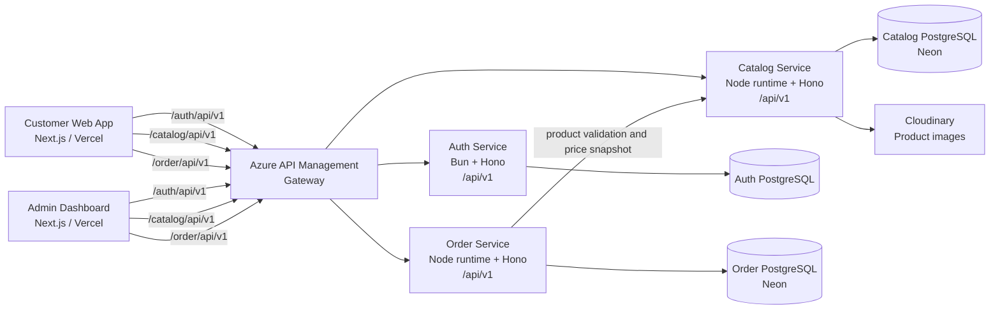

# Architecture

Nesta Foods uses a tenant-aware, service-oriented architecture. The customer
and admin Next.js applications call one gateway entry point, while each Hono
service owns a separate business area and database schema.

> **Verified boundary:** the frontend route prefixes and the service route
> prefixes are present in source code. The repositories do not include APIM
> policies or infrastructure definitions, so the exact Azure backend URLs,
> rewrite policies and subscription settings are deployment configuration
> outside these repositories.

## Components

### Auth Service

The Auth Service is a Bun/Hono API rooted at `/api/v1`. It owns registration,
login, access-token refresh, logout, password reset, sessions, tenants, users
and addresses. It validates request bodies with Zod, stores password hashes and
refresh-token hashes in PostgreSQL, and enforces role-based access for
`admin`, `manager`, `staff` and `customer` roles.

Access tokens can be supplied as an `HttpOnly` cookie or an `Authorization`
header. The catalog and order services verify the shared HS256 access-token
secret locally; they do not call the Auth Service for every request.

### Catalog Service

The Catalog Service owns tenant categories, products, variants, add-ons and
menu reads. It exposes authenticated management routes and public tenant menu
and product routes. Product image uploads are sent to Cloudinary, while
catalog records are stored through Drizzle ORM in PostgreSQL (the repository
uses Neon’s serverless PostgreSQL driver).

### Order Service

The Order Service owns customer and dashboard order workflows, order items,
add-ons, totals, status transitions and status history. Customer routes are
available under `/api/v1/orders`; dashboard routes are under
`/api/v1/admin/orders`.

At order creation, it calls the Catalog Service using `CATALOG_SERVICE_URL`.
The response is validated and the selected product, variant, add-on names and
prices are copied into the order. This preserves the price and display data
used by the order even if the catalog changes later.

## Frontend communication

Both frontends use Axios with `withCredentials: true` and a configured gateway
base URL. The customer app consumes authentication, public menu/product and
customer-order operations. The admin app consumes authentication, tenant/user
management, catalog management, health checks and admin-order operations.

The admin client retries a `401` once after calling `/api/v1/auth/refresh` and
redirects to sign-in if refresh fails. The customer client uses the same
cookie-based session model.

## Request flow

1. A frontend sends a credentialed request to the gateway path for the target
   service.
2. Azure API Management routes the request to the corresponding App Service.
3. The service validates the request and, where required, verifies the JWT and
   tenant/role claims.
4. The service reads or writes its own database. An order write may make a
   synchronous catalog read before persisting a price snapshot.
5. The service returns a JSON response envelope containing `success`, `message`,
   `data` and `status` where implemented.
